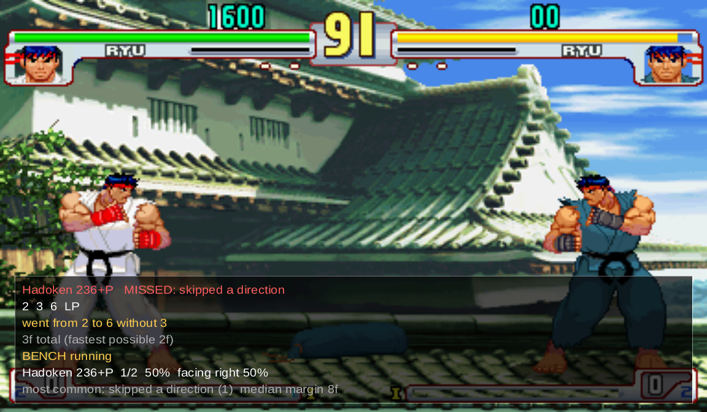

# Input grader

Frame-accurate feedback on special move inputs for Street Fighter III: 3rd Strike, as a Lua overlay for [Fightcade](https://www.fightcade.com/)'s FBNeo. After every attempt it tells you whether the move came out, how many frames each direction took against the window the game allows, and what went wrong when it did not.



The windows are the game's own: read from the command tables in the arcade ROM, and checked against the running game frame by frame (142,748 frames across every character, without a mismatch).

## Features

- **Per-attempt grading** of every special move and super art, for all 20 characters: the move you went for, whether it came out, and the frames used per step against each step's window.
- **Specific feedback** when it fails: a skipped diagonal ("went from 2 to 6 without 3"), a direction that came too late and by how many frames, a button too early or too late, a motion cancelled by up, or a different move coming out instead.
- **Timing summary**: frames from the first direction to the button, the fastest possible, and your tightest margin, so you can see how close a successful input was to failing.
- **Bench mode**: start a session, do reps, stop, and get success rates per move and per side, your most common mistake, your median margin, and first-ten against last-ten success.
- **Target move**: restrict grading and the bench to one move.
- **Attempt log**: every graded attempt appended to `logs/attempts.csv` for comparing sessions.
- **Runs alongside [3rd_training_lua](https://github.com/Grouflon/3rd_training_lua)** (hitboxes, frame data, dummy control) in the same Fightcade session.
- **Reference tables**: [every character's motions and windows](docs/windows.md), generated from the ROM.

## Requirements

- Fightcade 2 with 3rd Strike (the `sfiii3nr1` set, which Fightcade uses).
- This repository on the same machine. Fightcade's Linux Flatpak cannot see your home folder by default; see [Fightcade on Linux](#fightcade-on-linux).

## Quick start

1. Start 3rd Strike in Fightcade's training mode (or offline) and get into a match.
2. Open **Game > Lua Scripting > New Lua Script Window**, **Browse** to `input_grader.lua` in this repository, and **Run**.
3. Do a Hadoken (236+P). The card appears at the bottom of the screen.

## Controls

| Hotkey | Action |
| --- | --- |
| Alt+7 | Start a bench session, or stop it and show the results |
| Alt+8 | Cycle the target move: all moves, then each of your character's moves |
| Alt+9 | Hide or show the overlay |

## Reading the card

```
Hadoken 236+P   MISSED: skipped a direction
2  3  6  LP
went from 2 to 6 without 3
3f total (fastest possible 2f)
```

| Line | Meaning |
| --- | --- |
| Title | The move, its notation, and `OUT` or `MISSED` with the kind of mistake |
| Steps | Each direction and the button. `3 2/10` means 3 came 2 frames after the previous direction, of 10 allowed. `LP 0/10` means the button came on the frame the motion completed, of 10 allowed after it |
| Reason | What went wrong, in plain words (missed attempts only) |
| Timing | Frames from the first direction to the button, the fastest possible, and the tightest margin of any window |

The verdicts are explained in [how it works](docs/how-it-works.md#verdicts).

## Bench mode

Press Alt+7, do your reps, press Alt+7 again. The panel shows, per move: successes out of attempts, the success rate overall and per facing, the most common mistake, the median margin, and the success rate of your first ten attempts against your last ten. Choose a target with Alt+8 first to bench a single move.

Every graded attempt, bench or not, is appended to `logs/attempts.csv`: time, character, move, facing, result, mistake, per-step timings and margins.

## Running with 3rd_training_lua

FBNeo keeps one callback per hook, so two scripts loaded one after the other replace each other's hooks. The grader ships a launcher that runs both in one script:

```sh
tools/install-training-launcher.sh /path/to/3rd_training_lua
```

This writes `3rd_training_with_grader.lua` into the training folder. Load that file instead of `3rd_training.lua`. The training script's hotkeys (Alt+1 to Alt+3) and the grader's (Alt+7 to Alt+9) do not overlap. If Fightcade runs under Wine and the training folder is on another Wine drive, add `--windows-path`.

## Fightcade on Linux

The Fightcade Flatpak has no access to your files. Let it read this repository, write the log, and read the training folder:

```sh
flatpak override --user \
  --filesystem="$PWD":ro --filesystem="$PWD/logs" \
  --filesystem=/path/to/3rd_training_lua \
  com.fightcade.Fightcade
```

`tools/install-training-launcher.sh` prints this command with your paths filled in.

## What the game does that you might not expect

From the game's own code, each pinned by a test:

- Each direction must come within a window counted from the previous one: 10 frames for most steps, 14 for the second 2 of a super motion, 5 for the 2 of a Shoryuken.
- The button may come on the frame the motion completes or up to 10 frames later.
- Most specials also come out on the release of a button (negative edge).
- The Shoryuken's 6 can be held as long as you like; the 5-frame window starts when you let go of it.
- Holding down before a Hadoken re-arms the motion every 11 frames, so the 10 frames for the next direction count from the last re-arm, not from letting go of down. A slow roll through down-back after a long crouch can fail by luck of timing.
- Super motions do not check the last 6: 23623+P is enough.
- Only an exact up cancels a motion. Up-forward does not.

Details in [how it works](docs/how-it-works.md); every move's windows in [windows.md](docs/windows.md).

## Limitations

- P1 only.
- Validated in the real game on the Japan 990608 set. Fightcade's 990512 set has identical command tables and RAM layout as far as checked; a validation run on it is pending.
- Charge, 360 and mash moves are graded, with less specific feedback than motions.
- The end-to-end verdict checks use Ryu; other characters' command checks are validated frame by frame, but their verdicts have only been spot-checked.
- The screenshots come from the MAME test bench; FBNeo draws the same overlay with its own small font.
- Tested with Fightcade 2.4.2 (Flatpak) on Linux; not yet run inside Fightcade by the author of these tools.

## Development

Everything runs through the Nix flake, which pins the toolchain, MAME and the decomp:

```sh
nix develop                 # shell with LuaJIT, Lua 5.4, MAME, stylua, luacheck, Python
nix run .#check             # format check, lint, tests on LuaJIT and Lua 5.4
nix run .#test              # tests only
nix run .#check-roms        # which 3rd Strike sets are in roms/, by file hash
nix run .#gen               # regenerate the command tables from the ROM
nix run .#validate          # Lua checker against the running game, frame by frame
nix run .#grade             # live grader against scripted attempts in the running game
GRADE_SNAPSHOTS=1 nix run .#grade   # the same, saving screenshots to build/snaps
```

ROMs go in `roms/` (ignored by git) and are checked against `roms.sha1`. The real-game checks need `sfiii3.zip` and `sfiii3n.zip` (MAME set names); set `ROMSET=sfiii3nr1` to run them on Fightcade's revision. Engineering conventions are in [ENGINEERING.md](ENGINEERING.md); adding another game or emulator is described in [porting.md](docs/porting.md).

### Layout

| Path | Contents |
| --- | --- |
| `input_grader.lua` | The script to load in FBNeo |
| `lua/input_grader/core/` | Game-agnostic: app, bench, overlay, CSV log, hook multiplexer |
| `lua/input_grader/platform/` | FBNeo and MAME adapters |
| `lua/input_grader/games/sfiii3/` | 3rd Strike: generated tables, RAM map, checker port, tracker, grader |
| `harness/mame/` | Real-game validation and end-to-end checks |
| `tools/` | ROM decryption, table generation, ROM check, struct offsets, launcher installer |
| `tests/` | Unit tests (`lua tests/run.lua`) |
| `docs/` | How it works, porting, windows reference |

## Roadmap

- A validation run on Fightcade's `sfiii3nr1` set.
- P2 support, so you can grade from either side of a netplay or training session.
- A training journal: progress per move over days and weeks, built from the attempt log.
- A move cheatsheet on a hotkey: the current character's specials and selected super art, drawn with the same icons as the grid, with each step's window and the optional last directions. The command tables already hold everything it needs.
- A pinned FBNeo build under Wine in the flake, to try the script without Fightcade. FBNeo's Lua only exists in its Windows build, and its command line takes a game or a script but not both, so this would be a manual check rather than an automated one.
- Other games, using the porting interfaces.

## Credits

- [sfIII3-cps3-decomp](https://github.com/gibletto/sfIII3-cps3-decomp): the annotated arcade decompilation this project's understanding of the command check comes from. The checker port follows its `CMD_MAIN_2.C`, and the tables are labelled with its names.
- [3s-decomp](https://github.com/crowded-street/3s-decomp): the PS2 decompilation, used to get started.
- [3rd_training_lua](https://github.com/Grouflon/3rd_training_lua): player object and match state addresses, and an independent check of the RAM layout.
- [MAME](https://www.mamedev.org/): the headless test bench. [FBNeo](https://github.com/finalburnneo/FBNeo): the emulator Fightcade runs.

## Licence

Not chosen yet. The generated tables and the checker port derive from the arcade decomp, which is AGPL-3.0, so a public release would most simply be AGPL-3.0 too. ROMs are not included and never will be.
