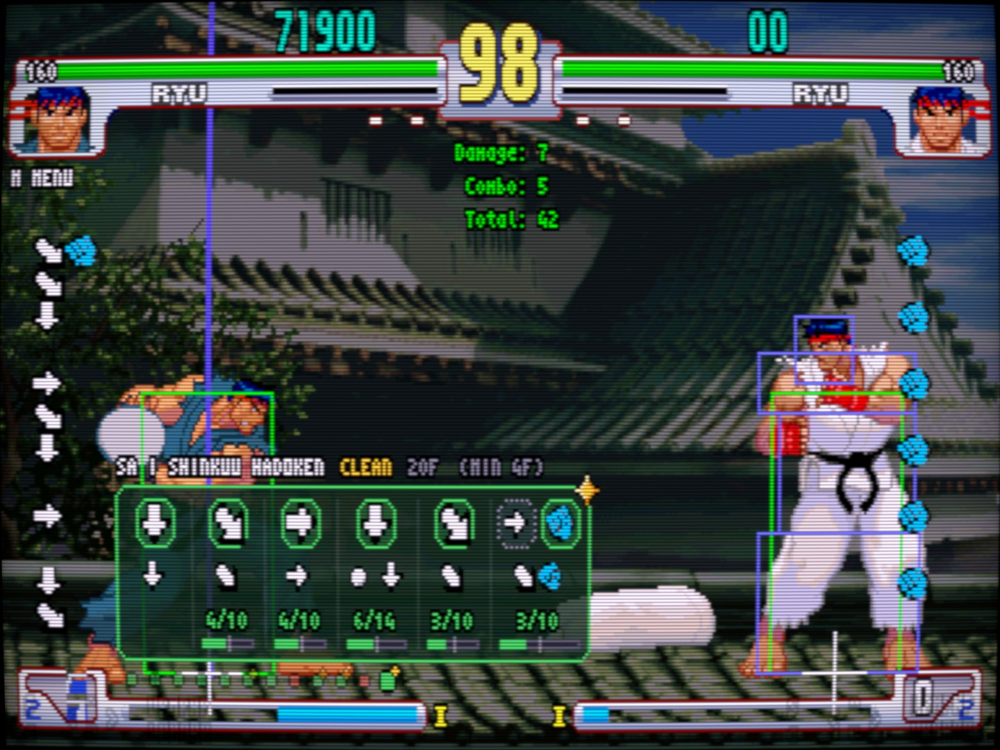
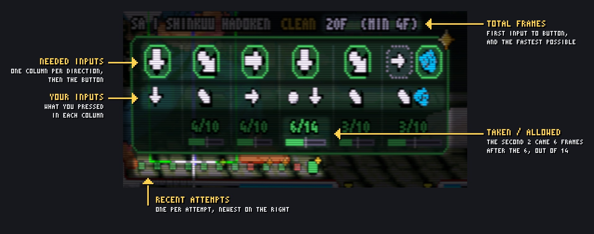
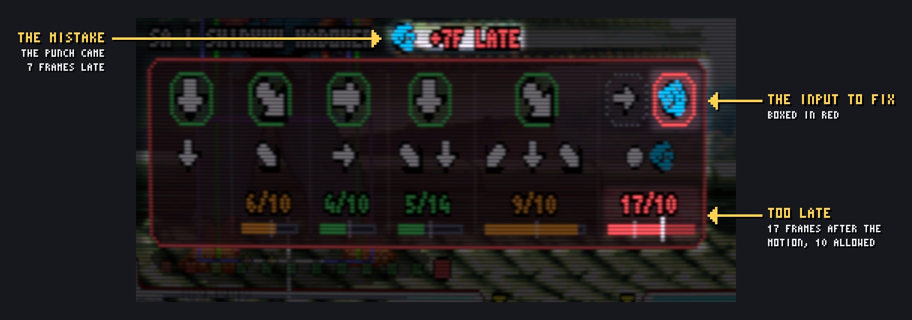

# Input grader

Input grader shows how you did each move in Street Fighter III: 3rd Strike, frame by frame. It runs as an overlay in [Fightcade](https://www.fightcade.com/)'s training mode. After each attempt you see the inputs the move needed, how many frames you took for each one against the window the game allows, and what went wrong if the move did not come out.

It grades special moves and super arts for all 20 characters, including charge, 360 and mash moves. It can also time dashes, a throw or a button right after a dash, and parries against the opponent's attacks.





The windows come from the game's own code, read from the arcade ROM.

## Install

You need Fightcade 2 with 3rd Strike, and a copy of this repository.

On Linux with Fightcade's Flatpak, start Fightcade once, then run:

```sh
tools/install-fightcade-addon.sh
```

On Windows, run the same script in Git Bash with the path to your training mode folder:

```sh
tools/install-fightcade-addon.sh "/c/path/to/Fightcade/emulator/fbneo/fbneo-training-mode"
```

Then start 3rd Strike with Fightcade's training mode as usual, and the grader loads with it. [Other setups](docs/install.md) covers Windows without Git Bash, running without the training mode, and running with 3rd_training_lua.

## Use

Do a special move or a super art, and a card appears for it. To drill one move, press M and pick it as your target. The grader then looks only for that move, and shows your success rate since you picked it.

| Key | Action |
| --- | --- |
| M | Open the menu. The stick moves through the list, LP picks a target and LK closes the menu |
| H | Hide or show the overlay |
| Page Up, Page Down | Step through your recent attempts |

Dashes, the high jump, the press after a dash and parries are graded only while you target them. If you map FBNeo's Lua Hotkeys 8 and 9, they do the same as M and H.

## Reading the card

| Part | Meaning |
| --- | --- |
| Meter | Green up to half the window, orange past half, red past the end. A dashed box above it marks an optional input, like the last 6 of a super |
| Name line | CLEAN when every input used at most half its window, FRAME-PERFECT for the fastest input possible, or what went wrong |
| Box | Green when the move came out, red when it did not, gold when it was frame-perfect. Grey when your input was right but the game refused the move, for example with no meter |

When a move fails, the card names the mistake, boxes the input that caused it, and shows by how many frames you missed:



Other mistakes it names include a skipped diagonal, a direction too slow, a button too early, a motion cancelled by up, and a cancel from a normal that came too late or whiffed.

Every attempt is also written to `logs/attempts.csv`, so you can compare sessions.

## Surprises in the game's input rules

The grader follows the game's own rules, and a few of them are not what most players expect. A super motion does not need its last 6, so 23623+P is enough. Only a straight up cancels a motion, and up-forward does not. The Shoryuken's 6 can be held as long as you like.

The [internals](docs/how-it-works.md#surprises-in-the-games-input-rules) list them all, and [windows.md](docs/windows.md) has every move's windows for every character.

## Limitations

The grader follows player 1 only. Its verdicts were checked in the real game with Ryu, and spot-checked with other characters. Charge, 360 and mash moves get less specific feedback than motions.

## Credits

The [arcade decompilation](https://github.com/gibletto/sfIII3-cps3-decomp) is where the grader's understanding of the game comes from, and [3s-decomp](https://github.com/crowded-street/3s-decomp) got the project started. [3rd_training_lua](https://github.com/Grouflon/3rd_training_lua) provided RAM addresses and a check of the RAM layout. The game runs in [FBNeo](https://github.com/finalburnneo/FBNeo) in Fightcade, and the tests run in [MAME](https://www.mamedev.org/).

## Development

Building, testing and the code layout are in [development.md](docs/development.md), conventions in [ENGINEERING.md](ENGINEERING.md), and plans in [roadmap.md](docs/roadmap.md). The licence is not chosen yet. ROMs are not included.
